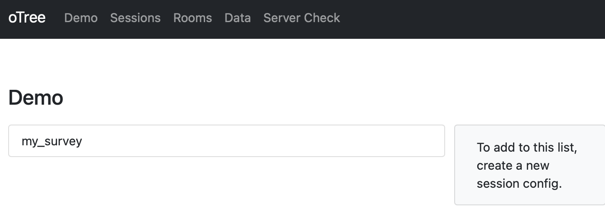

# Building a Survey

Now that you know how to create a new oTree project, let's move on to building a survey. For this, we don’t need to create a brand-new project completely from scratch. Instead, we can use the existing virtual environment and create a fresh project within it. 

### Creating the Project {.unnumbered}
- Make sure your virtual environment is activated. If you are following along from the previous chapter, it should already be active.

- Let’s create a new project for our survey. Open your terminal and type the following command[^noteproject]:  

[^noteproject]:  
    If you are not sure why, please refer to the [Creating a Project section](create-project.qmd).

```bash
otree startproject myexperiment
```

- This time, let’s keep things neat and tidy by not including the sample games. Enter `n` when prompted.  

- You should now see a new folder called `myexperiment` in your parent directory. Navigate into the folder and test if everything is working:

```bash
cd myexperiment
otree devserver
```

- If everything is working and you can access the oTree admin page, stop the server by pressing `Ctrl + C` and continue.

### Creating the App {.unnumbered}

- Before running the experiment, let’s create a new app for our survey:  

```bash
otree startapp survey
```

- This command creates a new folder called `survey`, which contains a template for our app. We’ll be modifying the files in this folder to build our survey.

- Note that this does not automatically add the app to our experimental flow. We also need to tell oTree to include this app. To do that, open `settings.py` (in the `myexperiment` directory) and modify the lines starting with `SESSION_CONFIGS` as the following:  

```python
SESSION_CONFIGS = [
     dict(
         name='my_survey',
         app_sequence=['survey'],
         num_demo_participants=3,
     ),
]

```

Here, we’re telling oTree that we want a session called `my_survey` that contains only the app `survey`.  

::: {.callout-note}
## A Look at SESSION_CONFIGS {.unnumbered}
`SESSION_CONFIGS` is a list of dictionaries defined in the project’s `settings.py`. Each dictionary represents a set of configurations for an experiment session.

In this case, we added a new dictionary with three keys:  

- `name`: The name of the session configuration. It should be unique, contain only letters, numbers, and underscores, and avoid spaces or hyphens.  
- `app_sequence`: The list of apps included in the session. Here, it’s just `survey`.  
- `num_demo_participants`: The number of demo participants for the test page. This usually matches or is a multiple of the group size. It’s not critical for the real experiment.  

It’s common to have one session config per treatment.
:::

- Now, let’s run the server again and see if our app has been added. Ensure you’re in the `myexperiment` directory, then run:  

```bash
otree devserver
```

and open in your browser at `http://localhost:8000`. This time you must see `my_survey` in the session list:



- You can keep the server running while modifying files. In most cases, you don’t need to restart it to see changes when using `devserver`.

## Structure of Our App {.unnumbered}

The oTree file and folder structure might look intimidating at first, but it’s actually straightforward. Let’s review the structure of our project:  

```
myexperiment
├── __pycache__
├── _static
├── _templates
├── db.sqlite3
├── requirements.txt
├── settings.py
└── survey
    ├── MyPage.html
    ├── Results.html
    ├── __init__.py
```

Key directories and files:  
- `_static`: For static files (e.g., images) that oTree needs to access.  
- `survey` (or any other app folder):  
  - `__init__.py`: Where the logic of the app lives (back-end). Most of our code will go here.  
  - HTML files: Define what participants see (front-end). Each page has a corresponding HTML file.  
- `settings.py`: The main settings file for the entire experiment. Used for adding apps, variables, and global configurations.

Now, let’s open the `__init__.py` file in our `survey` folder. It currently looks like this:

```python
from otree.api import *

doc = """
Your app description
"""

class C(BaseConstants):
    NAME_IN_URL = 'survey'
    PLAYERS_PER_GROUP = None
    NUM_ROUNDS = 1

class Subsession(BaseSubsession):
    pass

class Group(BaseGroup):
    pass

class Player(BasePlayer):
    pass

# PAGES
class MyPage(Page):
    pass

class ResultsWaitPage(WaitPage):
    pass

class Results(Page):
    pass

page_sequence = [MyPage, ResultsWaitPage, Results]
```

### Constants {.unnumbered}
- `C`: Stores constants that we’ll use throughout the experiment (e.g., number of rounds, URLs).

### Models {.unnumbered}
- `Subsession`, `Group`, `Player`: Represent subsessions, groups, and players.  
  - We’ll typically add variables (fields) to the `Player` class.  

### Pages {.unnumbered}
- `MyPage`, `ResultsWaitPage`, `Results`: Classes that represent pages.  
- Each page class corresponds to an HTML file with the same name. For example, `MyPage` ↔ `MyPage.html`.

### Page Sequence {.unnumbered}
- `page_sequence`: Defines the order in which pages are shown.

---

## Preparing the Files {.unnumbered}

Let’s clean up unnecessary code by deleting these lines from `__init__.py`:  

```python
class ResultsWaitPage(WaitPage):
    pass

class Results(Page):
    pass
```

And update the `page_sequence`:  

```python
page_sequence = [MyPage]
```

We can also delete `Results.html`.

---

## Looking at MyPage.html {.unnumbered}

Open `MyPage.html` and update it like this:  

```html
{{ block title }}
Welcome to our survey 
{{ endblock }}


    We would like you to answer the following questions. 
    Please do not leave any question blank.

   {{ formfields }}
   {{ next_button }}

```

At this stage, we have a page with a title, instructions, and placeholders for form fields.

---

## Creating Our Survey {.unnumbered}

When building an experiment, we generally:  
1. Define the variables in the `Player` class.  
2. Create page classes.  
3. Create HTML files for each page.  

For this survey, we want to ask:  
- Age (Integer)  
- Country (String)  
- Additional comments (Long text)  

Update the `Player` class:  

```python
class Player(BasePlayer):
    age = models.IntegerField(label='How old are you?')
    country = models.StringField(label='Please write the country you live in')
    comments = models.LongStringField(label='Please write your comments here')
```

Now we need to tell oTree which page should display these fields. In `MyPage`:

```python
class MyPage(Page):
    form_model = 'player'
    form_fields = ['age', 'country', 'comments']
```

Run the experiment again, try it out, and verify that the data is saved correctly.

---

## Formatting the Survey {.unnumbered}

The survey works, but let’s improve usability by adding constraints and predefined options.

### Age with Min/Max
```python
age = models.IntegerField(label='How old are you?', min=18, max=100)
```

### Country with Choices
```python
country = models.StringField(
    label='Please select the country you live in',
    choices=['Algeria', 'Colombia', 'France', 'Kenya', 'Turkey', 'Vietnam']
)
```


### Final Player Class
```python
class Player(BasePlayer):
    age = models.IntegerField(label='How old are you?', min=18, max=100)

    country = models.StringField(
        label='Please select the country you live in',
        choices=['Algeria', 'Colombia', 'France', 'Kenya', 'Turkey', 'Vietnam']
    )

    comments = models.LongStringField(label='Please write your comments here')
```

---

Our survey is now more user-friendly. It should not allow you to submit an age outside of the range, or an input that is not a number. Moreover you have a dropdown menu for selecting the country. oTree has many built-in form widgets that you might want to use. And you can also create your own custom designs if the built-in ones do not fit your needs. For more options, see the [Forms section in the oTree documentation](https://otree.readthedocs.io/en/latest/forms.html#forms).


Now you have learned to create a single-page survey in oTree. This provides the basis that we need to move further. For some, it all might look overly complex for a simple survey. But bear with us. oTree really shines when things get more complex. With several pages, mixes of different types of questions and above all, group experiments. The latter one is what we will explore next.